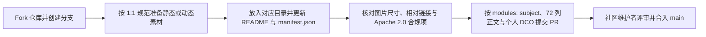

# 贡献指南与准则（Contributing Guide）

欢迎参与 **MissionHub 开源社区吉祥物仓库**的共创。无论您希望新增全新 IP 形象、为现有形象补充表情包、分享二次创作插画，还是协助完善文档与制作工具，本准则将帮助您的贡献顺畅合入仓库。

## 1. 欢迎贡献的内容

| 贡献方向 | 目标目录 | 示例 |
| --- | --- | --- |
| 新增社区 IP 形象 | `characters/<ip-slug>/` | 新角色档案、基础设定文档以及对应的 `static/`、`animated/` 1:1 表情包 |
| 扩展现有 IP 官方表情包 | `characters/<ip-slug>/static/` 或 `animated/` | 新增 1:1 静态 PNG 或动态 GIF / APNG / WebP 表情包，并同步更新 `manifest.json` 与角色 `README.md` |
| 提交社区二创作品 | `characters/<ip-slug>/community/<github-username>/<work-slug>/` | 同人插画、新主题梗图、像素风、正比立绘、头像壁纸、Live2D 或 3D 资源 |
| 完善设定与使用文档 | `docs/`、`README.md`、`README.en.md` | 补充设定细节、色板参数、使用示例或多语言翻译 |
| 开发配套制作与校验工具 | `tools/` | 1:1 裁切与尺寸转换脚本、多聊天软件打包脚本、元数据与链接校验器 |

## 2. 目录组织规范

本仓库按 IP 形象分目录管理，**每个 IP 形象内部统一划分静态表情包目录（`static/`）与动态表情包目录（`animated/`）**，同时保留独立的社区二创区（`community/`）：

| 路径 | 说明 |
| --- | --- |
| `characters/<ip-slug>/README.md` | 该 IP 形象的设定卡片、参考图展示、1:1 规格说明与全部静态、动态表情包完整图鉴 |
| `characters/<ip-slug>/manifest.json` | 该 IP 形象的结构化素材清单，记录参考图、文件名、分类、文案、尺寸与标签 |
| `characters/<ip-slug>/reference/` | 该 IP 形象的标准角色参考图（如正式正比形象、Q 版设定图与三视图，保留原始画幅比例） |
| `characters/<ip-slug>/static/` | 该 IP 形象的**静态表情包图**（严格 1:1 正方形） |
| `characters/<ip-slug>/animated/` | 该 IP 形象的**动态表情包图**（严格 1:1 正方形） |
| `characters/<ip-slug>/community/<github-username>/<work-slug>/` | 社区二创作品独立目录，内含作品 `README.md` 与 `static/` / `animated/` 子目录 |

- 目录名 `<ip-slug>` 与 `<work-slug>` 统一使用小写英文字母、数字和短横线（例如 `missionhub-chan`、`riscv-pack`）。
- 同一目录下文件名使用两位数字编号加短横线命名（例如 `01-deep-thinking.png`、`01-clapping.gif`），禁止空格与特殊符号。

## 3. 表情包格式与 1:1 尺寸要求

为保证素材在微信、飞书、Discord、Telegram、GitHub 页面以及后续制作工具中保持一致观感，**所有进入 `static/` 与 `animated/` 的表情包图必须满足 1:1 正方形画幅要求（`宽 = 高`）**：

| 类型 | 存放目录 | 画幅比例 | 格式要求 | 推荐分辨率 | 体积与质量建议 |
| --- | --- | --- | --- | --- | --- |
| 静态表情包图 | `static/` | **严格 1:1** | PNG（支持透明底或白底模切贴纸风） | `1024 × 1024 px` 或 `1254 × 1254 px`（最低 `512 × 512 px`） | 单文件建议 `≤ 5 MB`，边缘清晰无明显压缩噪点 |
| 动态表情包图 | `animated/` | **严格 1:1** | GIF（GIF89a）、APNG 或动态 WebP | `300 × 300 px` 至 `512 × 512 px`（v0.1 样稿为 `313 × 313 px` / `362 × 362 px`） | 单文件建议 `≤ 2 MB`，推荐 `6–15 fps`，循环衔接自然 |

- 如同时提供高清矢量或分层源文件（例如 SVG），可与作品说明一并整理并在 `README.md` 中注明用途。
- 表情包文字建议兼顾深色与浅色聊天背景的可读性（可参考 v0.1 样稿的纯白厚描边 + 细黑外框封装方式）。

## 4. 开源协议与知识产权准则

### Apache License 2.0（贡献自动授权）

本仓库整体依据根目录 [Apache License 2.0](LICENSE) 分发。根据协议第 5 条（Submission of Contributions），您主动向本仓库发起 Pull Request 并获合入的所有作品、文档与代码均默认以 **Apache License 2.0** 开源分发，允许社区继续自由使用、修改、二次创作与再分发。

提交前请确认以下事项：

1. **合法版权来源**：提交内容为您本人原创，或基于允许以 Apache 2.0 再分发的合法素材改编，并在说明中准确标注原作者与来源。
2. **无受限第三方资产**：请勿在作品中嵌入未经授权的商用字体、收费图库素材或受版权限制的动漫元素。
3. **第三方开源标识处理**：若开发者梗图中呼应了其他开源社区标识（如 Linux Tux、Zephyr、Yocto），须在 `manifest.json` 的 `third_party_references` 字段与说明文档中如实标注，避免暗示官方背书。

### 形象尊重与社区准则

- **尊重现实原型与社区成员**：MissionHub 娘（M 娘 / MH 娘）的创作灵感部分源自社区成员 River，二创作品须保持善意与分寸，不得用于冒犯、影射或不当调侃现实人物。
- **区分官方发布与社区二创**：依据 Apache 2.0 第 6 条，许可证不授予官方商标背书权；社区二创作品请注明创作者署名，不得以「MissionHub 官方出品」名义对外宣传。
- **维护积极健康的开源氛围**：拒绝违法违规、仇恨歧视、人身攻击或低俗恶意内容。

## 5. Git 提交规范与 DCO 签署

向本仓库提交的所有 Git commit **必须严格遵守以下三条规则**：

1. **标题采用 `modules: subject` 格式**：`modules` 使用小写字母开头，可包含小写字母、数字、`/` 与 `-`（例如 `missionhub-chan`、`missionhub-chan/animated`、`community`、`docs`、`tools`、`repo`）；`subject` 简洁概括本次变更内容。
2. **必须包含 commit body，且每行列宽不超过 72 个字符**：标题与正文之间空一行，正文与末尾 DCO 签署之间空一行；正文须清楚说明改动内容与目的；commit 标题、正文与签署行的**每一行列宽均不得超过 72 个字符**，避免制表符与行尾空白。
3. **必须签署个人 DCO**：每条提交必须附带作者本人的 [Developer Certificate of Origin (DCO)](https://developercertificate.org/) 签署行（`Signed-off-by: Your Name <your-email@example.com>`），签署邮箱须与该 commit 的作者邮箱一致，不得由他人代签。

标准提交示例：

```text
missionhub-chan: add riscv bring-up stickers

Add four 1:1 static PNG stickers for RISC-V bring-up and QEMU workflows,
and register their metadata in manifest.json.

Signed-off-by: Your Name <your-email@example.com>
```

当本人姓名与邮箱较长导致 `Signed-off-by` 单行超过 72 个字符时，可将邮箱放在以单个空格开头的续行：

```text
Signed-off-by: Your Full Name
 <your-long-email@example.com>
```

提交前请配置本人真实的 Git 姓名与邮箱，并使用 `git commit -s` 自动生成个人 DCO 签署：

```bash
git config user.name "Your Name"
git config user.email "your-email@example.com"
git commit -s
```

如需修正本地最新提交的格式或补签 DCO，可使用 `git commit --amend -s` 编辑提交信息。

## 6. 贡献流程



### 提交前自检清单

- 所有新增静态图和动态图均为 **1:1 正方形**，已分别归入 `static/` 与 `animated/`。
- 文件命名规范无空格，图片清晰度与文件体积符合建议范围。
- 涉及官方角色素材增改时，已同步更新该角色的 `manifest.json` 与 `README.md` 展示图鉴。
- 已确认所有 Markdown 相对路径与图片预览正常显示。
- 所有 Git 提交均采用 `modules: subject` 格式、包含完整 commit body、每行列宽不超过 72 个字符，并已签署本人真实的个人 DCO（`git commit -s`），同时同意按 Apache License 2.0 分发。

如有新角色设想、表情包选题或工具需求，欢迎先在仓库创建 Issue 与社区伙伴交流。
