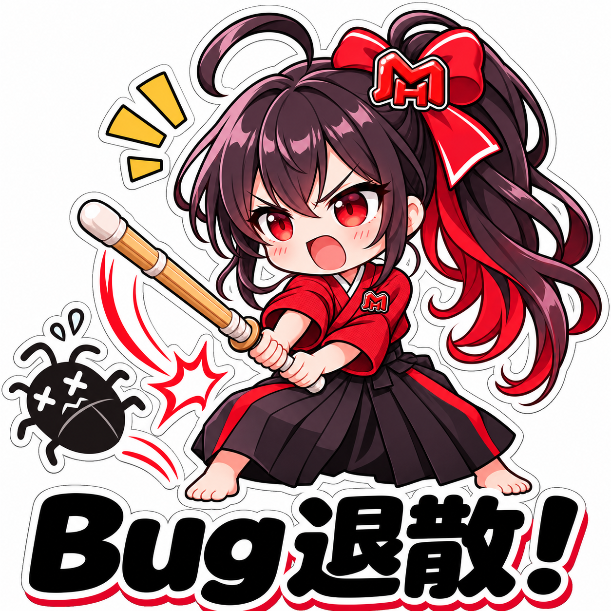
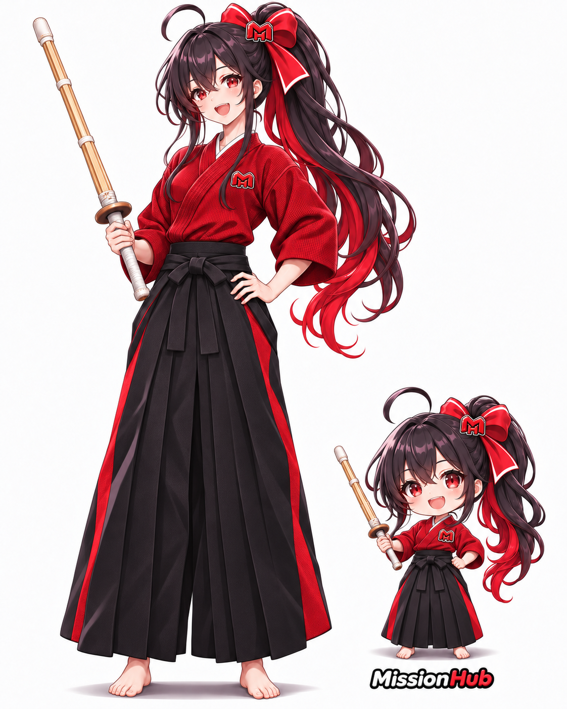
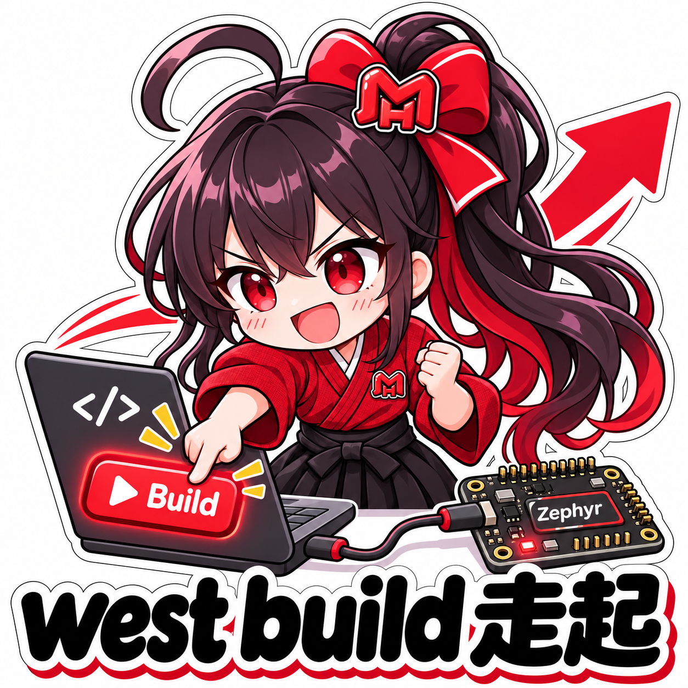

MISSIONHUB OPEN SOURCE COMMUNITY · OFFICIAL MASCOT HUB

  
  &nbsp;&nbsp;
  
  &nbsp;&nbsp;
  

<h1>MissionHub Mascot</h1>

  <strong>✨ MissionHub-chan · Energetic · Fearless · Built for Mission-Critical Engineering ✨</strong> 
  Official mascot repository for the MissionHub Open Source Community · 1:1 Static &amp; Animated Stickers · Apache 2.0

  
  
  
  

<a href="README.md">简体中文</a> · <strong>English</strong>

  <a href="#featured-ip">Featured IP</a> ·
  <a href="#sticker-showcase">Sticker Showcase</a> ·
  <a href="docs/ip-guide.md">IP Guide (ZH)</a> ·
  <a href="docs/usage-guidelines.md">Usage Guidelines (ZH)</a> ·
  <a href="CONTRIBUTING.md">Contributing Guide (ZH)</a> ·
  <a href="tools/README.md">Tools Roadmap</a>

---

Welcome to the **MissionHub Open Source Community Mascot Repository** (`missionhub-oss/mascot`). This repository hosts our anime mascot IP designs, **1:1 static and animated developer sticker packs**, usage guidelines, and community derivatives under the **[Apache License 2.0](LICENSE)**.

## Featured IP

<table width="100%">
  <tr>
    <td width="38%" align="center" valign="middle">
      
      

        <strong>No. 01 · MissionHub-chan (Standard + Chibi)</strong> 
        MissionHub 娘 / M 娘 / MH 娘 · Official Reference Sheet (v0.1 Draft)
      

    </td>
    <td width="62%" valign="middle">
      <h3>⚔️ MissionHub-chan — Kendo-Inspired Open-Source Mascot</h3>
      

        <strong>Original Form</strong>: Evolved from MissionHub's v1 stacked <strong>M-over-H</strong> logo into an official dual-form reference sheet pairing a full-body <strong>standard anime form</strong> (~6.5–7 heads) with a 2-head <strong>chibi form</strong> that anchors all 1:1 static and animated stickers — featuring a deep espresso-plum high side ponytail with crimson highlights, curved ahoge, dual M/H emblems on her red bow and chest, sashiko-textured crimson kendo-gi, charcoal pleated hakama with crimson side stripes, barefoot dojo stance, and traditional bamboo shinai.
      

      

        <strong>Inspirations</strong>: 
        1. <strong>v1 M-over-H Logo × IFC Community Feedback × Internet Culture</strong>: Turning the original geometric emblem into an expressive anime character shaped by IFC community suggestions and developer memes. 
        2. <strong>Real-World Muse River</strong>: Inspired by teammate <strong>River</strong> — warm, gentle, meticulous, and a formidable <strong>4th-dan Kendo practitioner</strong> — uniting approachable warmth with relentless courage to solve mission-critical problems.
      

      

        
        
        
        
        
      

      

        <a href="characters/missionhub-chan/README.md"><strong>Browse Full Character Gallery (Reference + 20 Static + 3 Animated) →</strong></a> &nbsp;·&nbsp;
        <a href="docs/ip-guide.md">IP Specification</a> &nbsp;·&nbsp;
        <a href="characters/missionhub-chan/community/README.md">Community Derivatives</a>
      

    </td>
  </tr>
</table>

## Sticker Showcase

Every sticker follows a strict **1:1 square aspect ratio** organized cleanly into `static/` and `animated/` per character.

| Animated (1:1) | Animated (1:1) | Animated (1:1) | Agent (`1254 × 1254`, 1:1) |
| :---: | :---: | :---: | :---: |
|  **01 Clapping** |  **02 Surprised!!** |  **03 Dazed** |  **02 Agent, Start!** |
|  **08 Bug Away!** |  **12 Kernel Panic!** |  **17 west build** |  **18 BitBake Wait** |

Browse all 23 stickers and the official reference sheet in [`characters/missionhub-chan/README.md`](characters/missionhub-chan/README.md) and [`characters/missionhub-chan/manifest.json`](characters/missionhub-chan/manifest.json).

## Directory Structure & 1:1 Spec

Each IP character lives under `characters/<ip-slug>/` with dedicated `static/` (1:1 PNG) and `animated/` (1:1 GIF / APNG / WebP) folders:

| Path | Description |
| --- | --- |
| [`README.md`](README.md) / [`README.en.md`](README.en.md) | Top-level landing pages and live IP visual gallery |
| [`CONTRIBUTING.md`](CONTRIBUTING.md) | Contribution rules, 1:1 format & size standards, Apache 2.0 Section 5 inbound licensing, and DCO sign-off guide |
| [`LICENSE`](LICENSE) / [`NOTICE`](NOTICE) | Apache License 2.0 text, copyright notice, and third-party trademark clarification (Linux Tux, Zephyr, Yocto) |
| [`docs/ip-guide.md`](docs/ip-guide.md) | Character background, visual breakdown, sampled color palette, and v0.1 roadmap |
| [`docs/usage-guidelines.md`](docs/usage-guidelines.md) | Apache 2.0 rights & obligations, attribution templates, trademark boundaries, and community etiquette |
| [`characters/missionhub-chan/`](characters/missionhub-chan/README.md) | MissionHub-chan hub containing `reference/` (standard &amp; chibi sheet), `static/` (1:1), `animated/` (1:1), `manifest.json`, and `community/` |
| [`tools/README.md`](tools/README.md) | Planned creation, validation, and multi-platform export tools |

## License & Contributions

All assets and docs are distributed under **[Apache License 2.0](LICENSE)**. You are free to use, modify, create derivatives from, and redistribute them (including commercially) by preserving copyright notices, `LICENSE`, [`NOTICE`](NOTICE), and modification notes (Section 4), while respecting trademark boundaries (Section 6). Contributions submitted via PR require DCO sign-off (`git commit -s`); see [`CONTRIBUTING.md`](CONTRIBUTING.md).
