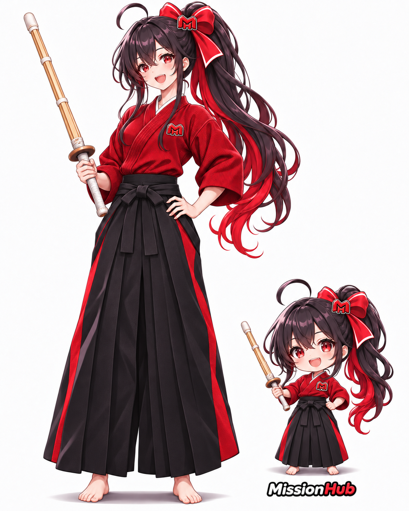
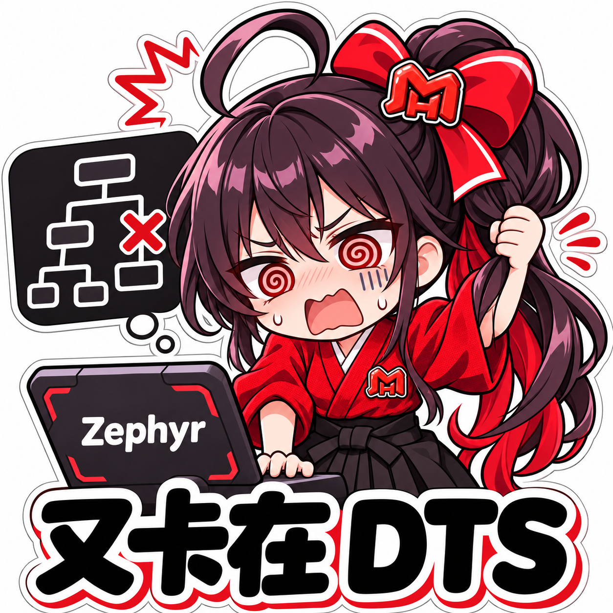
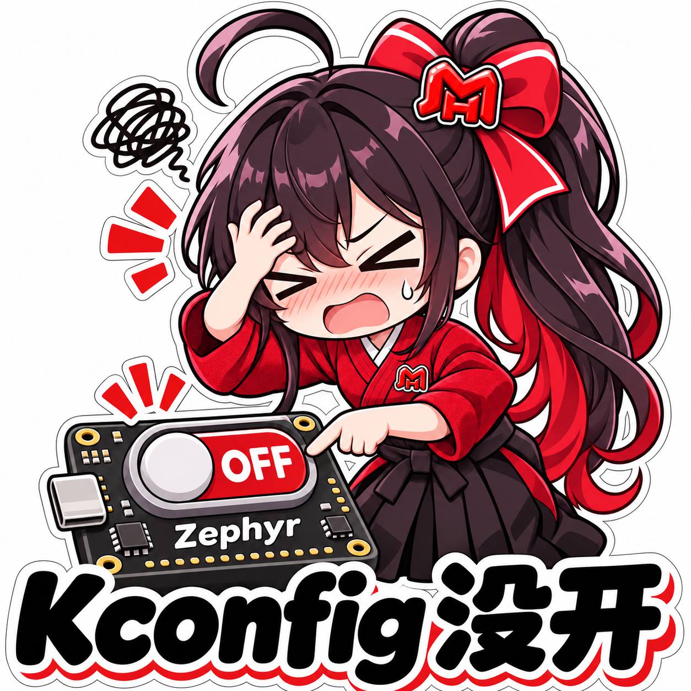
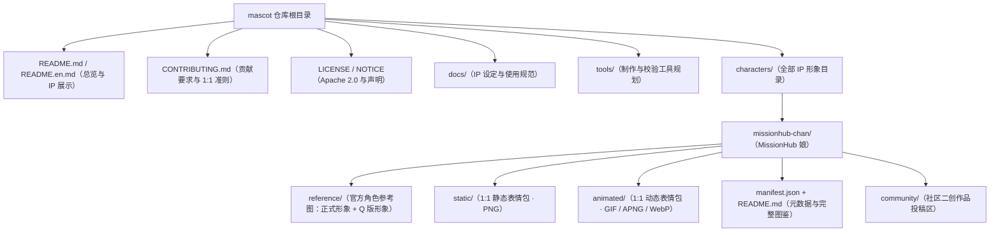

MISSIONHUB OPEN SOURCE COMMUNITY · OFFICIAL MASCOT HUB

  
  &nbsp;&nbsp;
  
  &nbsp;&nbsp;
  

<h1>MissionHub Mascot</h1>

  <strong>✨ MissionHub 娘（M 娘 / MH 娘）· 年轻朝气 · 一往无前 · 解决关键任务问题 ✨</strong> 
  MissionHub 开源社区官方吉祥物形象仓库 · 1:1 静态 / 动态表情包 · Apache 2.0 开放二创

  
  
  
  

  
  
  
  
  

<strong>简体中文</strong> · <a href="README.en.md">English</a>

  <a href="#现有-ip-形象">现有 IP 形象</a> ·
  <a href="#表情包展示墙">表情包展示墙</a> ·
  <a href="docs/ip-guide.md">IP 设定与设计元素</a> ·
  <a href="docs/usage-guidelines.md">使用与二创规范</a> ·
  <a href="CONTRIBUTING.md">贡献准则</a> ·
  <a href="tools/README.md">制作工具规划</a>

---

欢迎来到 **MissionHub 开源社区吉祥物之家**。这里汇聚社区原创二次元吉祥物设定、**1:1 静态与动态开发者表情包**、使用指南与社区共创作品，全仓库以 **[Apache License 2.0](LICENSE)** 开放分发，欢迎拿去聊天斗图、装点项目 README，也欢迎拿起画笔加入二次创作。

## 现有 IP 形象

<table width="100%">
  <tr>
    <td width="38%" align="center" valign="middle">
      
      

        <strong>No. 01 · MissionHub 娘（正式形象 + Q 版形象）</strong> 
        M 娘 / MH 娘 / MissionHub-chan · 官方参考图（v0.1 草稿样稿）
      

    </td>
    <td width="62%" valign="middle">
      <h3>⚔️ MissionHub 娘 — 提竹刀破局的剑道系开源少女</h3>
      

        <strong>原始形象</strong>：脱胎于社区第一版「<strong>上 M 下 H</strong>」Logo，官方参考图完整确立了约 6.5–7 头身<strong>正式正比形象</strong>与 2 头身<strong>标准 Q 版形象</strong>，所有 1:1 静态与动态表情包均以此原始形象为母本衍生。标志特征包括深紫棕黑高侧马尾配赤红挑染、跃动弧形大呆毛、红白大蝴蝶结与左胸双 MH 立体徽章、使命红刺子纹剑道服、带赤红竖向侧条的炭黑百褶剑道袴、赤脚稽古细节与暖木剑道竹刀。
      

      

        <strong>灵感来源</strong>： 
        ① <strong>社区第一版 Logo × IFC 社区建议 × 网络流行元素</strong>：保留「上 M 下 H」品牌构型，采纳 IFC 社区二次元化建议并结合当下开发者热梗，将品牌标识自然融入二次元造型。 
        ② <strong>真实人物原型 River</strong>：取材自社区同事 <strong>River</strong>——一位亲切可爱的萌妹、功底深厚的<strong>剑道四段</strong>高手，为人热情、细腻、细心、温柔且实力雄厚，赋予角色外柔内刚、一往无前、勇克关键任务问题的精神灵魂。
      

      

        
        
        
        
        
      

      

        <a href="characters/missionhub-chan/README.md"><strong>进入角色图鉴（参考图 + 20 静态 + 3 动态）→</strong></a> &nbsp;·&nbsp;
        <a href="docs/ip-guide.md">阅读完整设定文档</a> &nbsp;·&nbsp;
        <a href="characters/missionhub-chan/community/README.md">社区二创作品区</a>
      

    </td>
  </tr>
</table>

## 表情包展示墙

所有表情包严格遵循 **1:1 正方形画幅**，在微信、飞书、Discord、Telegram 与 GitHub 评论区均可直接导入使用。

### 🎬 动态表情（`animated/` · 1:1 · GIF）

<table width="100%">
  <tr>
    <td width="33%" align="center" valign="top">
      
      

        <strong>01 鼓掌欢迎</strong> 
        <code>01-clapping.gif</code> 
        362 × 362 · 12 帧 · 欢迎 / PR 合入祝贺
      

    </td>
    <td width="33%" align="center" valign="top">
      
      

        <strong>02 眼前一亮</strong> 
        <code>02-surprised.gif</code> 
        362 × 362 · 12 帧 · 惊喜发现 / 灵感迸发
      

    </td>
    <td width="34%" align="center" valign="top">
      
      

        <strong>03 放空发呆</strong> 
        <code>03-dazed.gif</code> 
        313 × 313 · 16 帧 · 大脑过载 / 编译等待
      

    </td>
  </tr>
</table>

### 🎨 静态表情精选（`static/` · `1254 × 1254 px` · 1:1）

覆盖 **Agent**、**日常开发**、**Linux**、**Zephyr**、**Yocto** 五大硬核技术场景：

| Agent 冲锋 | Agent 冲锋 | Agent 冲锋 | Agent 冲锋 |
| :---: | :---: | :---: | :---: |
|  **深度思考中…** |  **Agent，启动！** |  **Token 烧光了** |  **还得我来** |

| 工程协作 | 工程协作 | Linux 内核 | Linux 内核 |
| :---: | :---: | :---: | :---: |
|  **Bug 退散！** |  **LGTM，合了！** |  **Kernel Panic！** |  **先看 dmesg** |

| Zephyr RTOS | Zephyr RTOS | Yocto 构建 | Yocto 构建 |
| :---: | :---: | :---: | :---: |
|  **又卡在 DTS** |  **west build 走起** |  **BitBake 还在烤** |  **改一行，编一天** |

<strong>点击展开：查看其余 8 张 1:1 静态表情包（全套共 20 张）</strong>

 

| Agent | Agent | 工程协作 | 工程协作 |
| :---: | :---: | :---: | :---: |
|  **你又幻觉了** |  **上下文又丢了** |  **本地明明能跑** |  **别动，能跑！** |

| 工程协作 | Linux 内核 | Zephyr RTOS | Yocto 构建 |
| :---: | :---: | :---: | :---: |
|  **测试全绿！** |  **驱动，给我起！** |  **Kconfig 没开** |  **缓存没了** |

## 仓库目录结构与 1:1 规范

仓库采用可扩展的多 IP 架构：**每个 IP 形象独占 `characters/<ip-slug>/` 目录，内部直接划分为 `static/`（静态 1:1 表情包）与 `animated/`（动态 1:1 表情包）**，同时配套元数据与社区二创区。

| 路径 | 用途说明 |
| --- | --- |
| [`README.md`](README.md) / [`README.en.md`](README.en.md) | 仓库中英文总首页与现有 IP 形象展示墙 |
| [`CONTRIBUTING.md`](CONTRIBUTING.md) | 贡献要求、目录组织规范、1:1 格式尺寸标准、DCO 签署与 PR 自检准则 |
| [`LICENSE`](LICENSE) / [`NOTICE`](NOTICE) | 完整 Apache License 2.0 协议正文、社区版权声明与第三方开源元素说明 |
| [`docs/ip-guide.md`](docs/ip-guide.md) | MissionHub 娘（v0.1 草稿样稿）完整背景、设计寓意、全部视觉元素与色板参数 |
| [`docs/usage-guidelines.md`](docs/usage-guidelines.md) | Apache 2.0 权利义务、署名模板、官方背书边界与二次创作建议 |
| [`characters/missionhub-chan/`](characters/missionhub-chan/README.md) | MissionHub 娘资产目录：含 `reference/`（正式与 Q 版参考图）、`static/`（1:1 静态图）、`animated/`（1:1 动态图）、`manifest.json` 与 `community/` |
| [`tools/README.md`](tools/README.md) | 后续制作工具预留目录（1:1 校验、多平台导出、标准模板等） |

### 1:1 表情包规格速查

| 分类 | 目录 | 画幅要求 | 格式 | 推荐分辨率 | 体积建议 |
| --- | --- | :---: | --- | --- | --- |
| 静态表情包图 | `static/` | **严格 1:1** | PNG | `1024 × 1024 px` 或 `1254 × 1254 px`（最低 `512 × 512 px`） | `≤ 5 MB` |
| 动态表情包图 | `animated/` | **严格 1:1** | GIF / APNG / WebP | `300 × 300 px` 至 `512 × 512 px` | `≤ 2 MB` |

## 开放共创与许可

<table width="100%">
  <tr>
    <td width="33%" valign="top">
      <h4>📜 Apache License 2.0</h4>
      
全仓库依据 <a href="LICENSE">Apache License 2.0</a> 开源分发，允许自由使用、修改、二创与商业再分发；分发时保留版权、许可证与 <a href="NOTICE">NOTICE</a> 声明，并区分官方与社区二创。

      
<a href="docs/usage-guidelines.md">阅读使用与二创规范 →</a>

    </td>
    <td width="33%" valign="top">
      <h4>🎨 加入社区共创</h4>
      
欢迎贡献全新 IP 形象、1:1 静态或动态表情包、不同画风同人插画或 Live2D 模型。贡献合入同样遵循 Apache 2.0 与 DCO 签署规范。

      
<a href="CONTRIBUTING.md">阅读 CONTRIBUTING.md 贡献准则 →</a>

    </td>
    <td width="34%" valign="top">
      <h4>🛠️ 制作工具路线图</h4>
      
当前为 v0.1 第一版草稿样稿。后续将在 <code>tools/</code> 发布 1:1 自动检验、多平台尺寸导出与统一风格制作辅助工具，欢迎一起共建。

      
<a href="tools/README.md">查看制作工具规划 →</a>

    </td>
  </tr>
</table>
