

MISSIONHUB MASCOT · CHARACTER NO. 01

<h1>MissionHub 娘（M 娘 / MH 娘）</h1>

  <strong>年轻朝气 · 一往无前 · 勇于挑战困难 · 解决关键任务问题</strong> 
  全部表情包统一采用 <strong>1:1 正方形</strong>画幅，划分为 <code>static/</code>（静态）与 <code>animated/</code>（动态）两大目录

  <a href="../../docs/ip-guide.md">IP 设定与设计元素</a> ·
  <a href="../../docs/usage-guidelines.md">使用与二创规范</a> ·
  <a href="manifest.json">manifest.json</a> ·
  <a href="community/README.md">社区二创区</a> ·
  <a href="../../CONTRIBUTING.md">参与贡献</a>

---

## 原始形象与灵感来源

### 原始形象

MissionHub 娘（M 娘 / MH 娘）的原始图形起点是 **MissionHub 社区第一版「上 M 下 H」Logo**。在保留品牌核心识别符号的基础上，进一步拟人化并确立了完整的双形态原始形象（见下方官方核心参考图）：

- **正式形象（Standard Form）**：约 6.5–7 头身青春剑道少女全身立绘，深紫棕黑高侧马尾配赤红挑染、头顶弧形大呆毛、红白大蝴蝶结与胸口双「上 M 下 H」徽章、使命红菱格刺子纹剑道服、带赤红竖向侧条的炭黑百褶剑道袴、赤脚自然站立、右手持暖木剑道竹刀、左手叉腰。
- **Q 版形象（Chibi Form）**：约 2 头身二次元萌系全身设定，与正式形象保持完全一致的造型语言，作为全部 1:1 静态与动态表情包的母本与视觉基准。

### 灵感来源

1. **社区第一版 Logo × IFC 社区二次元化建议 × 网络流行元素**：提取第一版「上 M 下 H」Logo 构型，结合 IFC 社区给出的二次元化建议与活跃的网络和开发者流行文化，把品牌标识转化为发饰与道服上的立体红白徽章，赋予角色鲜活的社区共鸣。
2. **现实人物原型 —— 同事 River**：灵感源自社区与团队成员 **River**。她是一位亲切可爱的萌妹，同时也是**剑道四段**的高手；为人热情、细腻、细心、温柔，专业实力十分雄厚。她身上「温柔细致又充满力量、面对困难毫不退缩」的气质，构成了 MissionHub 娘的剑道造型与年轻朝气、一往无前、勇克关键任务问题的精神核心。

## 官方核心参考图（`reference/`）

<table width="100%">
  <tr>
    <td width="42%" align="center" valign="middle">
      <a href="reference/missionhub-chan-reference.png">
        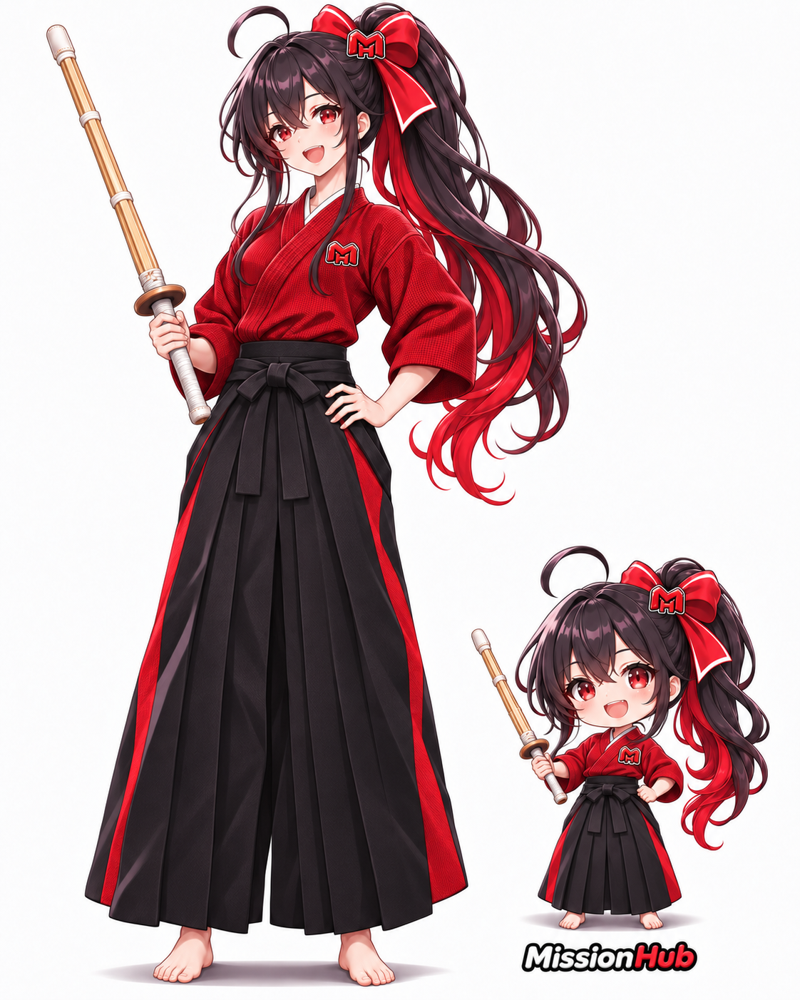
      </a>
    </td>
    <td width="58%" valign="middle">
      <h3>正式形象 + Q 版形象标准参考</h3>
      <ul>
        <li><strong>文件</strong>：<a href="reference/missionhub-chan-reference.png"><code>reference/missionhub-chan-reference.png</code></a>（PNG，<code>1122 × 1402 px</code>）</li>
        <li><strong>正式形象（左）</strong>：约 6.5–7 头身日系青春少女全身立绘，右手持剑道竹刀、左手叉腰、赤脚自然站立，完整呈现使命红菱格刺子纹剑道服与带赤红竖向侧条的炭黑百褶剑道袴。</li>
        <li><strong>Q 版形象（右下）</strong>：约 2 头身萌系全身设定，与正式形象保持完全一致的发型、徽章与服饰特征，作为全部 1:1 表情包的标准视觉基准。</li>
      </ul>
      
详细元素拆解与色板参数请查看 <a href="../../docs/ip-guide.md">IP 设定与视觉元素说明</a>。

    </td>
  </tr>
</table>

## 目录与资产规格

| 目录 | 资产类型 | 比例要求 | 当前数量 | 格式与实测分辨率 |
| --- | --- | :---: | :---: | --- |
| [`reference/`](reference/missionhub-chan-reference.png) | 角色标准参考图 | 原画幅 | 1 张 | PNG（8-bit RGB），`1122 × 1402 px`（正式形象 + Q 版形象） |
| [`static/`](static/) | 静态表情包图 | **1:1** | 20 张 | PNG（8-bit RGB），`1254 × 1254 px` |
| [`animated/`](animated/) | 动态表情包图 | **1:1** | 3 张 | GIF（GIF89a），`313 × 313 px` / `362 × 362 px` |
| [`community/`](community/README.md) | 社区二创作品 | 表情包 **1:1** | 开放投稿 | 遵循 [Apache License 2.0](../../LICENSE) |

---

## 动态表情包（`animated/` · 1:1）

| 预览 | 编号 / 文件 | 规格 | 适用场景与画面描述 |
| :---: | --- | --- | --- |
|  | `01-clapping.gif` | `362 × 362 px` · 1:1 · 12 帧（1.20 s） | 开心大笑并举起双手轻快鼓掌。适用于欢迎新贡献者、PR 合入祝贺、发版里程碑与活动开场。 |
|  | `02-surprised.gif` | `362 × 362 px` · 1:1 · 12 帧（1.08 s） | 双眼亮起金色星芒、头顶冒出双感叹号 `!!` 惊喜张嘴。适用于眼前一亮、灵感迸发、发现绝妙方案或重大突破。 |
|  | `03-dazed.gif` | `313 × 313 px` · 1:1 · 16 帧（2.40 s） | 半眯红宝石双眸、小嘴微张呆萌发呆。适用于大脑过载放空、读长日志愣神或漫长编译等待。 |

---

## 静态表情包（`static/` · 1:1）

### 一、Agent 与大模型开发（01–06）

| 预览 | 预览 | 预览 |
| :---: | :---: | :---: |
| 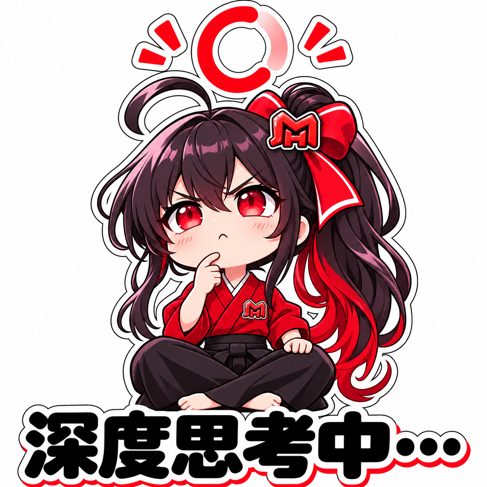 **01 深度思考中…** `01-deep-thinking.png` |  **02 Agent，启动！** `02-agent-start.png` | 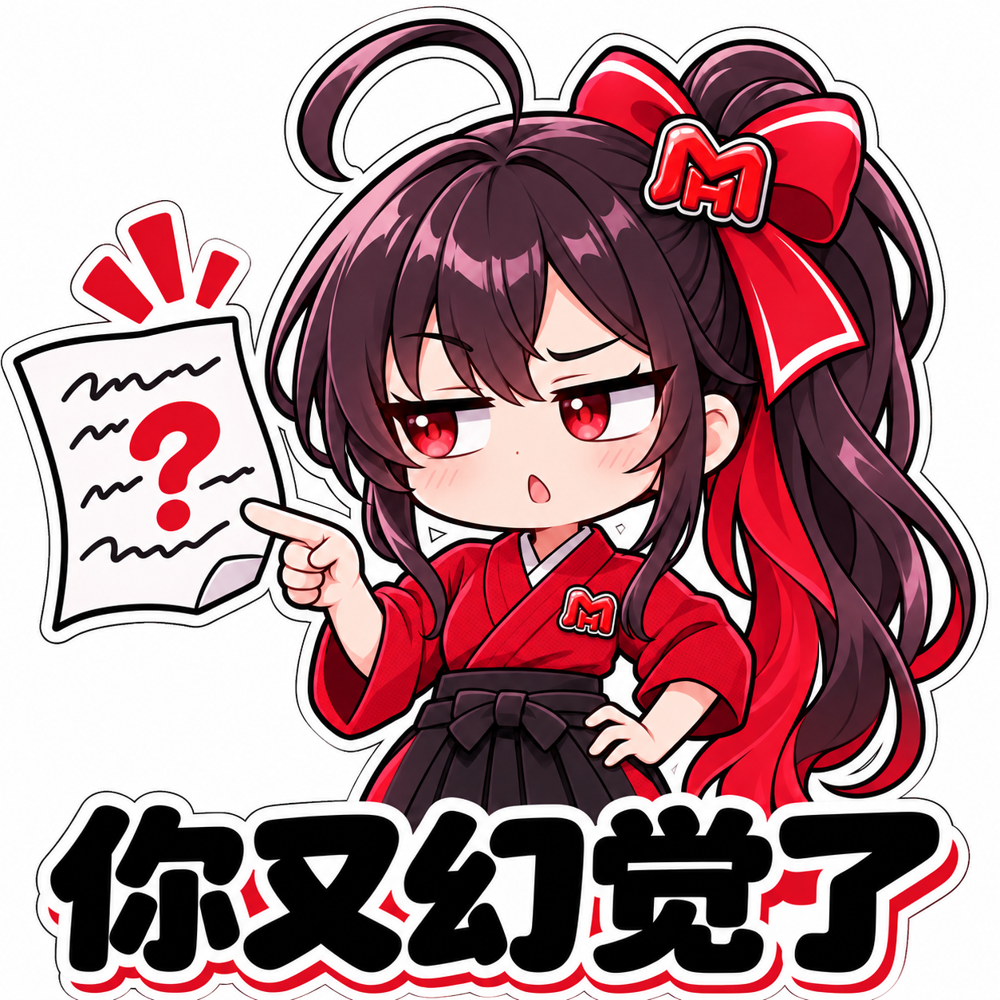 **03 你又幻觉了** `03-hallucination.png` |
| 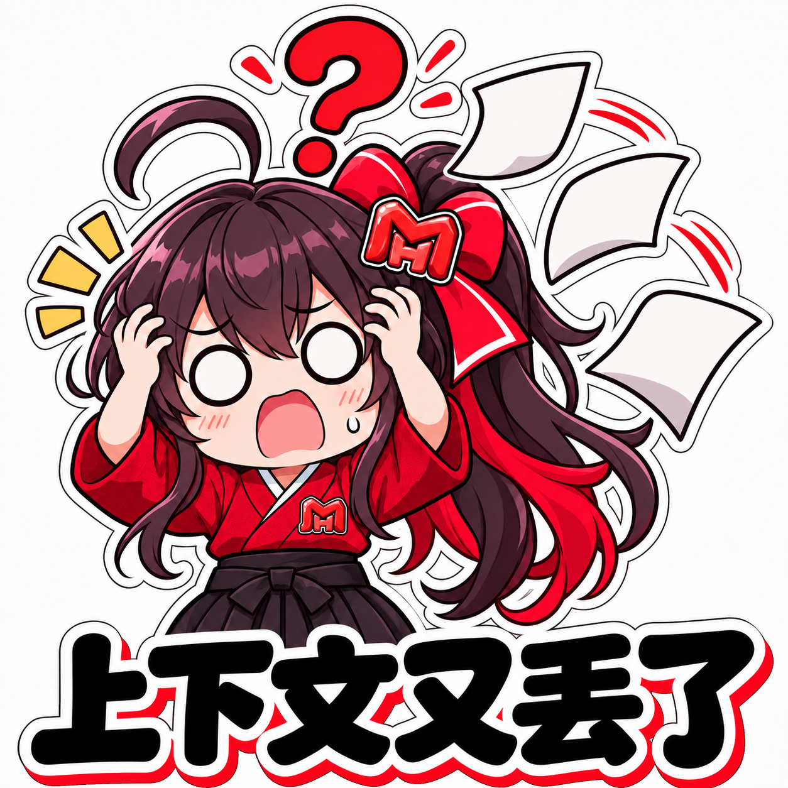 **04 上下文又丢了** `04-context-lost.png` |  **05 Token 烧光了** `05-tokens-empty.png` |  **06 还得我来** `06-human-takeover.png` |

| 编号 | 文件名 | 画面文案 | 画面与使用场景 |
| --- | --- | --- | --- |
| 01 | `01-deep-thinking.png` | 深度思考中… | 盘腿赤脚托腮皱眉思考，头顶红色加载圆环；用于等待长推理或认真分析问题。 |
| 02 | `02-agent-start.png` | Agent，启动！ | 右手高举竹刀、左手按下红色启动按钮元气大喊；用于开启自动化任务或工作流。 |
| 03 | `03-hallucination.png` | 你又幻觉了 | 叉腰半眯眼指向写满问号与乱波浪线的输出纸页；用于调侃模型编造内容或错误回答。 |
| 04 | `04-context-lost.png` | 上下文又丢了 | 双手抱头豆豆白眼大喊，三张空白文档向右侧飞散；用于长对话遗忘前文或压缩失忆场景。 |
| 05 | `05-tokens-empty.png` | Token 烧光了 | 跪地瀑布泪大哭，倒拎红色口金零钱包掉出最后一枚星芒硬币与火苗；用于额度耗尽吐槽。 |
| 06 | `06-human-takeover.png` | 还得我来 | 自信坏笑卷起右袖准备亲自操作报错笔记本，身旁倚着竹刀；用于人工接管排查难题。 |

### 二、日常开发与工程协作（07–11）

| 预览 | 预览 | 预览 |
| :---: | :---: | :---: |
|  **07 本地明明能跑** `07-works-locally.png` |  **08 Bug 退散！** `08-bug-away.png` | 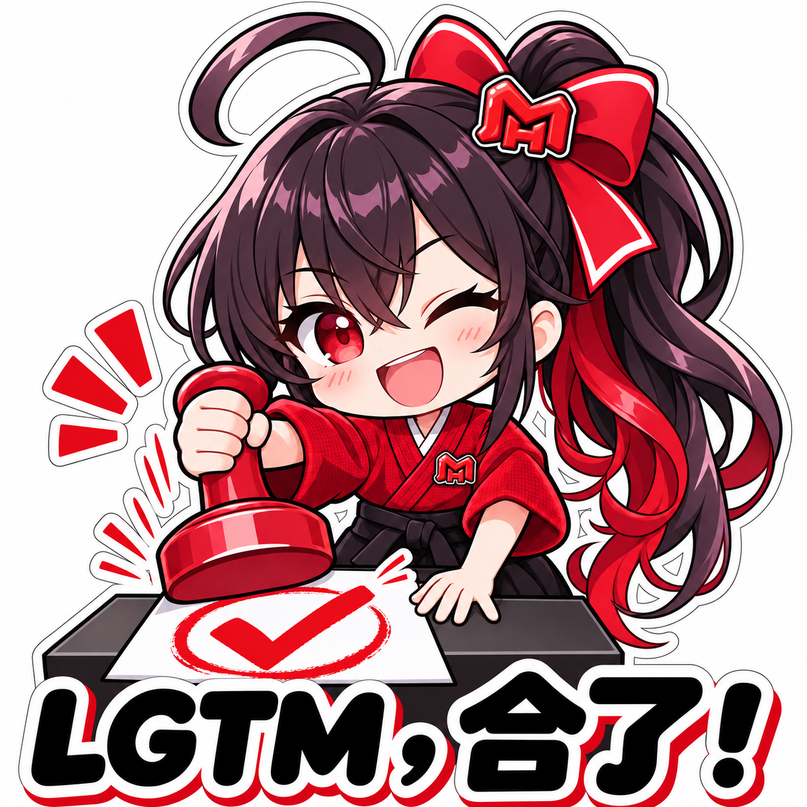 **09 LGTM，合了！** `09-lgtm-merge.png` |
| 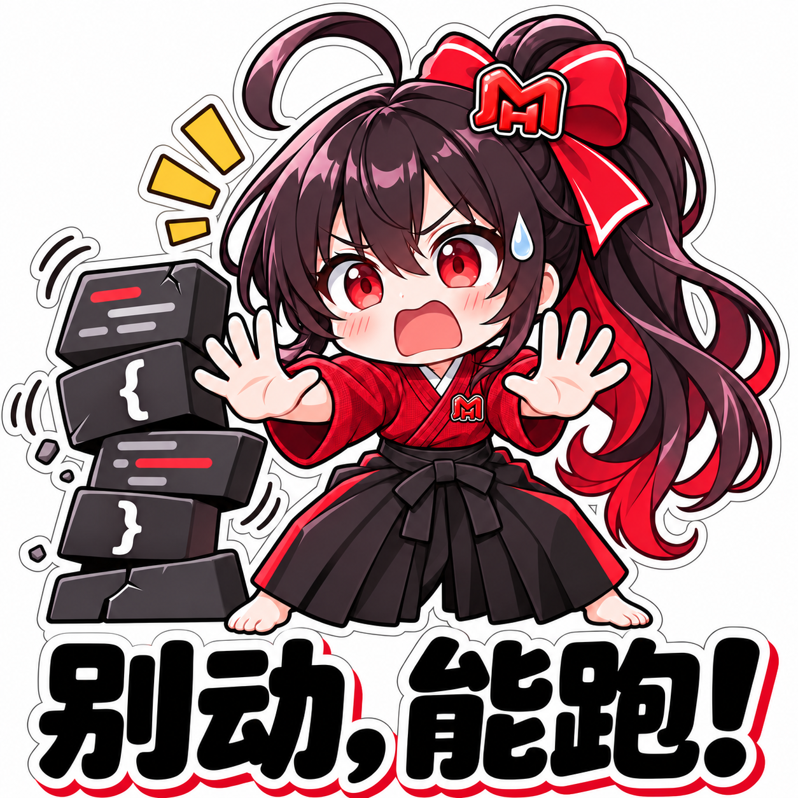 **10 别动，能跑！** `10-dont-touch.png` |  **11 测试全绿！** `11-tests-pass.png` | |

| 编号 | 文件名 | 画面文案 | 画面与使用场景 |
| --- | --- | --- | --- |
| 07 | `07-works-locally.png` | 本地明明能跑 | 鼓腮含泪冒青筋，抱着打着白色对勾的笔记本摊手委屈；用于环境差异与 CI 复现排查。 |
| 08 | `08-bug-away.png` | Bug 退散！ | 赤脚扎马步双手挥动竹刀劈出红白剑气，直接击飞小黑甲虫 Bug；用于修完顽固缺陷或上线祈福。 |
| 09 | `09-lgtm-merge.png` | LGTM，合了！ | 灿烂眨眼大笑，右手用力盖下大红对勾印章；用于代码评审通过与合并 PR。 |
| 10 | `10-dont-touch.png` | 别动，能跑！ | 冒汗扎马步伸手全力阻拦，身旁一摞带花括号裂纹的代码积木摇摇欲坠；用于发版前冻结改动。 |
| 11 | `11-tests-pass.png` | 测试全绿！ | 弯眼欢呼腾空跃起高举双拳，身旁笔记本屏幕亮起三个绿勾；用于 CI 与单元测试全部通过。 |

### 三、Linux 内核与驱动开发（12–14）

| 预览 | 预览 | 预览 |
| :---: | :---: | :---: |
|  **12 Kernel Panic！** `12-kernel-panic.png` |  **13 先看 dmesg** `13-read-dmesg.png` | 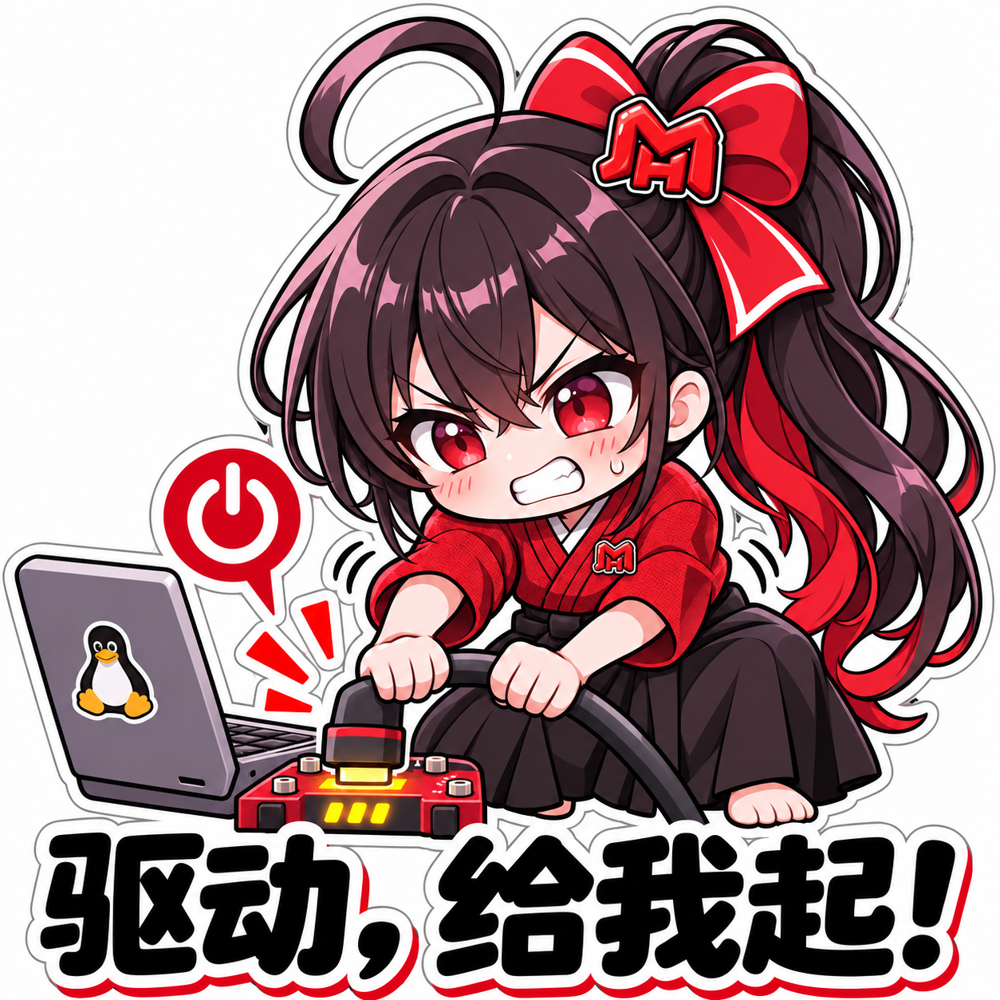 **14 驱动，给我起！** `14-driver-start.png` |

| 编号 | 文件名 | 画面文案 | 画面与使用场景 |
| --- | --- | --- | --- |
| 12 | `12-kernel-panic.png` | Kernel Panic！ | 双手抱头惊恐尖叫，终端报出 `kernel panic - not syncing: Fatal exception`，桌角小企鹅直冒冷汗；用于内核崩溃现场。 |
| 13 | `13-read-dmesg.png` | 先看 dmesg | 戴圆框眼镜、举起金框放大镜细查命令行窗口；用于温和提醒先查看内核启动与运行日志。 |
| 14 | `14-driver-start.png` | 驱动，给我起！ | 咬牙使劲双手将电缆插头按向红黑硬件开发板，一旁触发电源启动图标；用于新板卡点亮与驱动调通。 |

### 四、Zephyr RTOS 嵌入式开发（15–17）

| 预览 | 预览 | 预览 |
| :---: | :---: | :---: |
| 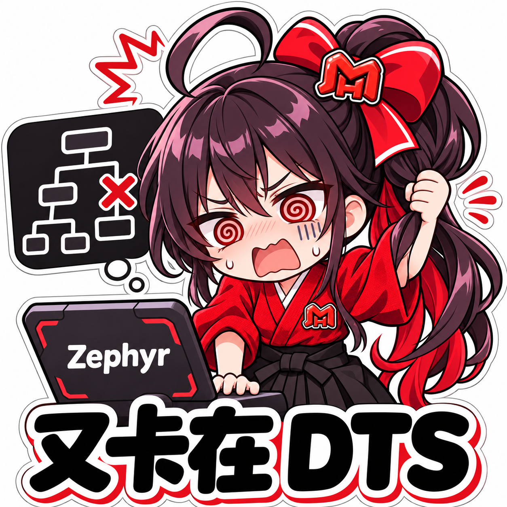 **15 又卡在 DTS** `15-dts-trouble.png` | 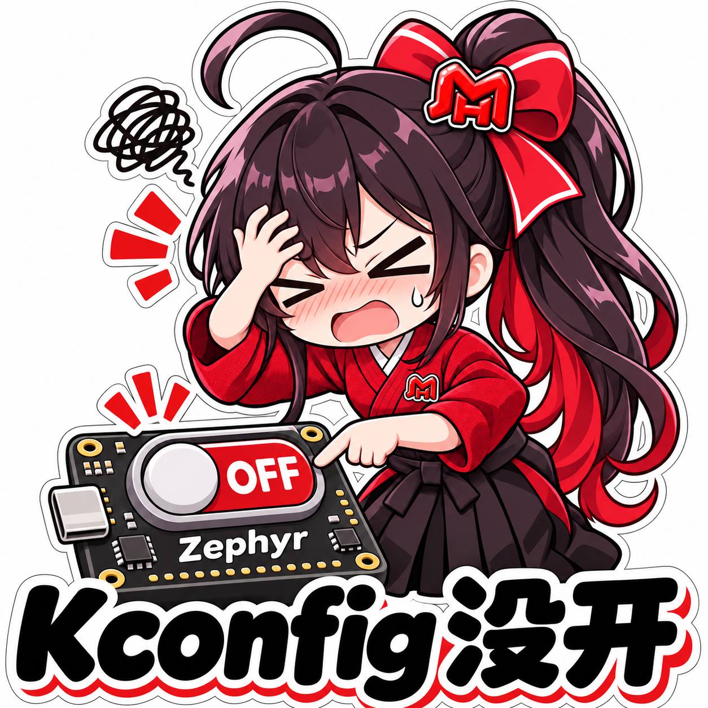 **16 Kconfig 没开** `16-kconfig-off.png` | 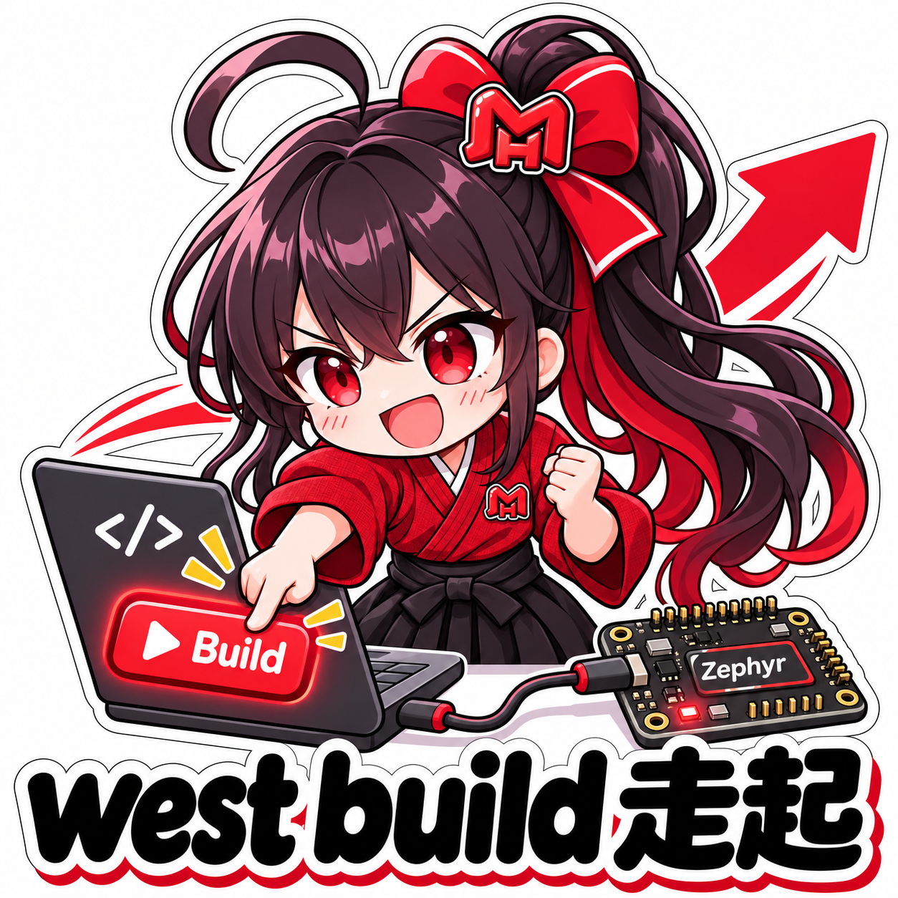 **17 west build 走起** `17-west-build.png` |

| 编号 | 文件名 | 画面文案 | 画面与使用场景 |
| --- | --- | --- | --- |
| 15 | `15-dts-trouble.png` | 又卡在 DTS | 双眼转起蚊香圈、揪着马尾崩溃抓狂，左侧设备树层级图出现红叉；用于排查设备树绑定与节点覆盖错误。 |
| 16 | `16-kconfig-off.png` | Kconfig 没开 | 捂额紧闭双眼懊恼自责，手指点向 `Zephyr` 电路板上处于 `OFF` 状态的红色拨动开关；用于忘记开启配置宏的恍然大悟瞬间。 |
| 17 | `17-west-build.png` | west build 走起 | 斗志昂扬握拳按下笔记本上发光的 `Build` 按钮，连线开发板红灯点亮、背后升起红箭头；用于开始编译与烧录。 |

### 五、Yocto 构建系统（18–20）

| 预览 | 预览 | 预览 |
| :---: | :---: | :---: |
| 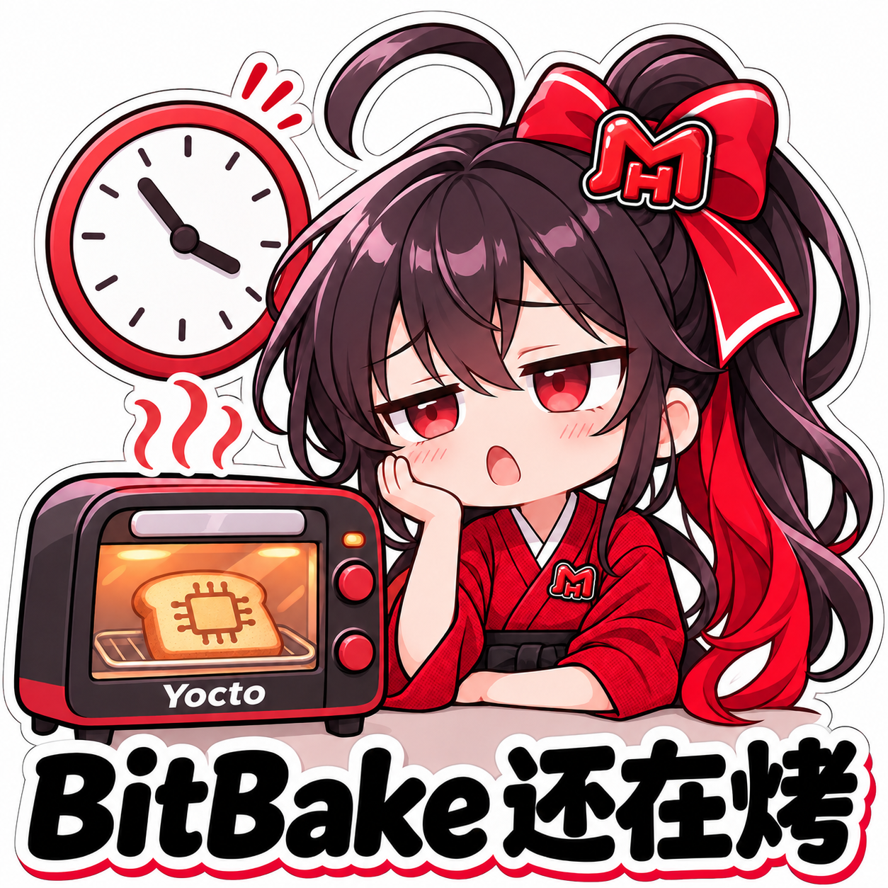 **18 BitBake 还在烤** `18-bitbake-wait.png` | 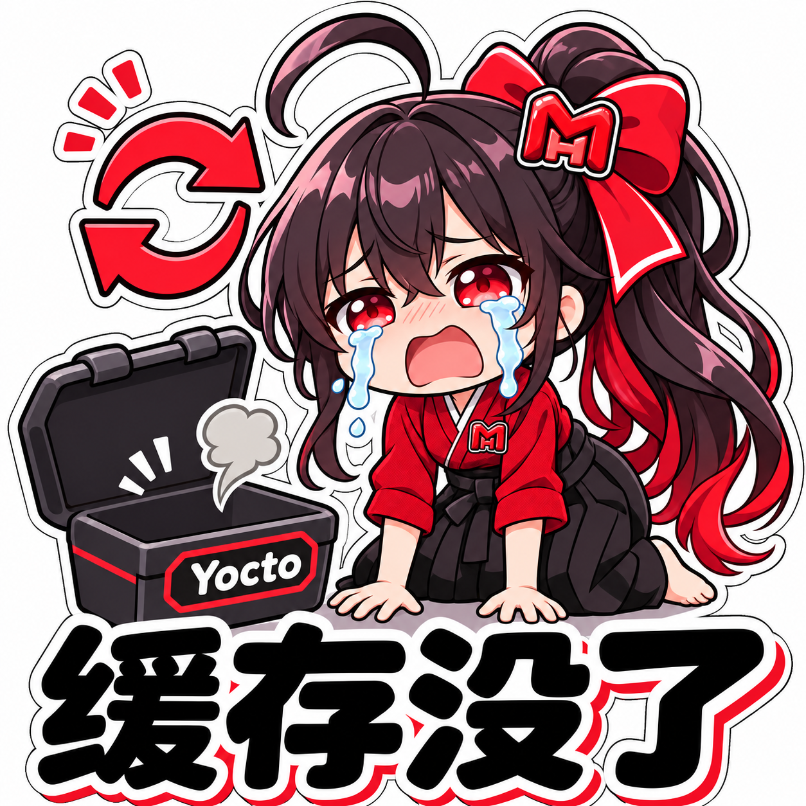 **19 缓存没了** `19-cache-gone.png` | 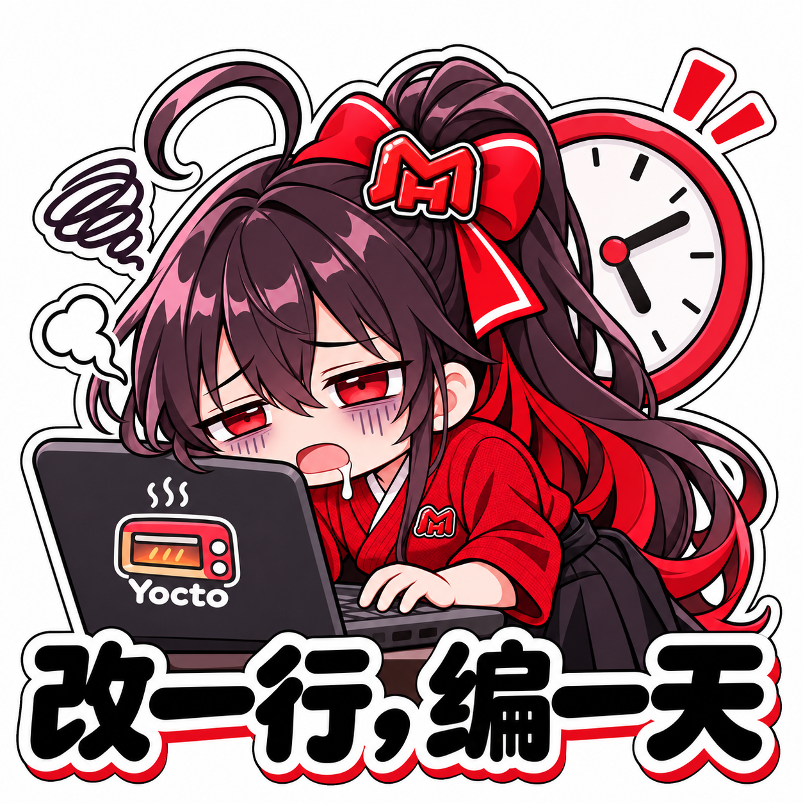 **20 改一行，编一天** `20-one-line-rebuild.png` |

| 编号 | 文件名 | 画面文案 | 画面与使用场景 |
| --- | --- | --- | --- |
| 18 | `18-bitbake-wait.png` | BitBake 还在烤 | 托腮放空等待，身前 `Yocto` 迷你烤箱正慢悠悠烤着一片芯片吐司，墙上挂钟滴答走动；用于漫长镜像烘焙等待。 |
| 19 | `19-cache-gone.png` | 缓存没了 | 跪趴大哭，旁边 `Yocto` 黑色工具箱空空如也冒出灰烟，头顶悬着红色刷新箭头；用于 `sstate-cache` 失效或误删缓存现场。 |
| 20 | `20-one-line-rebuild.png` | 改一行，编一天 | 挂着黑眼圈嘴角流口水软绵绵趴在 `Yocto` 笔记本上，背后大钟指针飞转；用于改动一行配方触发全量重编的真实写照。 |

---

## 聊天软件导入提示

- **飞书 / 钉钉 / 企业微信 / 微信**：直接保存 `static/` 中的 PNG 或 `animated/` 中的 GIF，在聊天窗口的自定义表情中添加即可使用。
- **Telegram / Discord**：所有素材均为 1:1 正方形，可直接按目标平台最大像素上限（例如 `512 × 512 px`）等比缩放上传；后续将在 [`tools/`](../../tools/README.md) 中提供自动转换与打包脚本。
