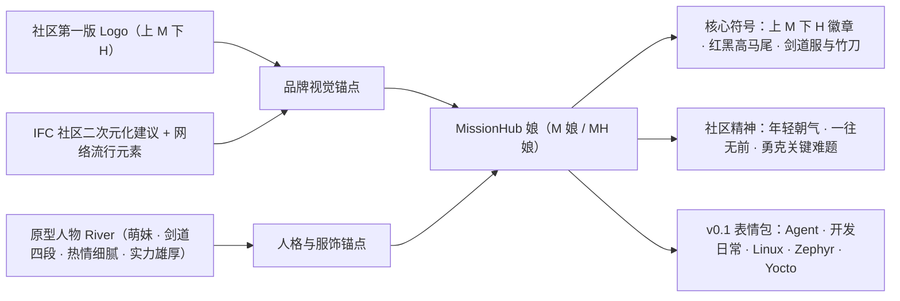
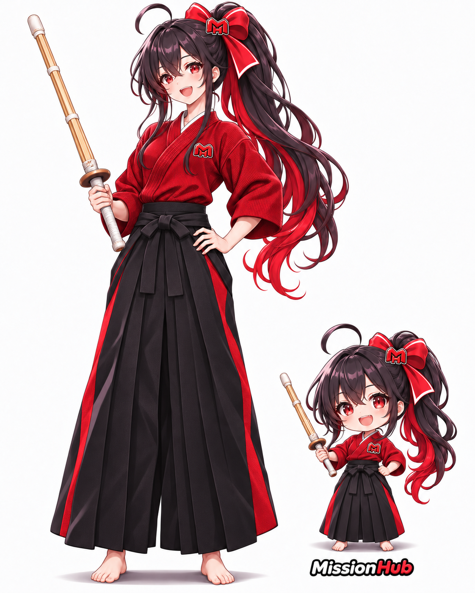

# MissionHub 娘（M 娘 / MH 娘）IP 设定与视觉元素说明

> [!NOTE]
> **版本状态：v0.1 草稿样稿（Draft）**
> 本文档、官方角色参考图（含正式形象与 Q 版形象）以及首批 20 张静态表情包与 3 张动态表情均为第一版草稿样稿，用于确立核心形象方向并开放社区共创。后续将结合社区反馈补充侧背面三视图、矢量 Logo 源文件与配套制作工具。

## 1. 角色档案

| 项目 | 设定内容 |
| --- | --- |
| 中文称呼 | MissionHub 娘、M 娘、MH 娘（三者均可通用） |
| 英文称呼 | MissionHub-chan |
| 所属社区 | MissionHub 开源社区（[missionhub-oss](https://github.com/missionhub-oss)） |
| 形象代次 | 社区第一代官方吉祥物形象（v0.1 草稿样稿） |
| 核心意象 | 上 M 下 H 社区徽章、红黑剑道服、竹刀、高侧马尾与赤红挑染 |
| 性格特质 | 年轻朝气、热情细腻、温柔细心、沉着果敢、实力出众 |
| 精神主张 | 一往无前，勇于挑战困难，迎难而上解决关键任务问题 |
| 首批发布主题 | Agent、日常工程协作、Linux、Zephyr、Yocto 开发者表情包 |
| 分发协议 | [Apache License 2.0](../LICENSE) |

## 2. 原始形象与灵感来源

MissionHub 开源社区致力于面向关键底层系统与前沿工程实践的开源协作，涵盖 Agent、Linux、Zephyr、Yocto 等技术方向。为了拉近开发者之间的距离、赋予社区更鲜明且富有温度的视觉符号，社区正式推出第一个 IP 吉祥物形象——**MissionHub 娘**。

### 2.1 原始形象演进与母本定位

- **品牌图形起点**：MissionHub 娘最初脱胎于 **MissionHub 社区第一版「上 M 下 H」Logo**。在二次元拟人化演进过程中，原本的叠合字母构型被保留并升格为角色最具辨识度的立体红白双层徽章，佩戴于头顶红色大蝴蝶结中央与剑道服左胸。
- **标准原始形象母本**：完整原始形象以 [官方核心参考图](../characters/missionhub-chan/reference/missionhub-chan-reference.png) 为基准，同时确立**正式正比形象**（约 6.5–7 头身全身立绘，展现修长剑道服剪影、赤红侧条百褶袴与持竹刀叉腰的自信站姿）与**标准 Q 版形象**（约 2 头身萌系全身立绘）。仓库内全部 1:1 静态与动态开发者表情包均由这套原始形象衍生展开。

### 2.2 两大核心灵感来源

#### 灵感来源一：社区第一版 Logo、IFC 社区建议与网络流行元素

- **上 M 下 H 品牌基因**：MissionHub 社区第一版 Logo 采用辨识度极高的「上 M 下 H」叠合构型，呼应社区名称 MissionHub 的首字母，经立体圆润化处理后与角色发饰和服饰浑然一体。
- **IFC 社区的二次元化建议**：结合 IFC 社区伙伴给出的二次元化造型思路，将原本偏工程与几何感的品牌视觉转化为更具亲和力的萌系二次元角色，借助红黑撞色、大蝴蝶结与富有张力的表情强化记忆点。
- **网络流行表达与开发者文化**：融入当下高频使用的网络热梗与开发者日常共鸣（如「深度思考中…」「Agent，启动！」「你又幻觉了」「别动，能跑！」「BitBake 还在烤」「改一行，编一天」等），让吉祥物在社群讨论、PR 评审与日常吐槽中都能自然派上用场。

#### 灵感来源二：现实人物原型 —— River

角色的性格底色与标志性剑道设定，取材自社区与团队成员 **River**：

- **外萌内刚的反差魅力**：River 是一位性格亲切的萌妹，待人**热情、细腻、细心、温柔**，让身边的伙伴感到安心与温暖。
- **剑道四段的硬核实力**：在温柔外表之下，她是资深剑道爱好者，拥有**剑道四段**的深厚功底，专业实力与抗压能力同样出众。
- **化为角色灵魂**：这种「温柔细致时能拿放大镜逐行排查 `dmesg`，关键时刻提刀挽袖就能正面劈开难题」的鲜明特质，赋予了 MissionHub 娘真实可信的人格魅力，也让红黑剑道服与竹刀成为整个形象最具辨识度的文化标签。

### 2.3 原始形象与灵感要素关联图

## 3. 设计寓意

1. **年轻朝气**：明快的使命红主调、高高束起的蓬松侧马尾、跃动的弧形呆毛以及极富感染力的表情，传递开源社区生机勃勃、乐于分享的氛围。
2. **一往无前**：剑道讲究「气、剑、体一致」与正大光明的进击姿态。角色高举竹刀按下启动键、双手挥刀驱散 Bug 的动作，寓意面对未知领域果断出击、毫不退缩。
3. **细腻温柔与可靠实力并存**：工程研发既需要冲锋陷阵的勇气，也需要抽丝剥茧的耐心。戴圆框眼镜细查内核日志、耐心守候构建流程、在报错时刻自信卷袖接管，体现了既有温度又能挑大梁的工程师品质。
4. **勇于挑战困难，解决关键任务问题**：紧扣 MissionHub 名字中的「Mission（关键任务）」含义——无论是复杂的内核异常、棘手的设备树配置、漫长的镜像构建，还是反复出现幻觉的 Agent 任务，她都代表着与开发者并肩破局的伙伴形象。

## 4. 完整视觉设计元素说明

   
  MissionHub 娘官方核心参考图（左：正式正比形象 · 右下：Q 版形象 · 文件：<code>characters/missionhub-chan/reference/missionhub-chan-reference.png</code>）

以下设计元素基于官方核心参考图以及 v0.1 草稿样稿中的 20 张静态表情包与 3 张动态表情提炼而成，作为官方迭代与社区二次创作的参考基准。

### 4.1 画风、形态设定与贴纸封装

- **画风定位**：日系萌系二次元赛璐璐插画风，采用清晰利落的黑色外轮廓线与干净明快的双层阴影，兼顾可爱度与高对比视觉冲击力。
- **双形态标准比例**：
  - **正式形象（Standard Form）**：约 6.5–7 头身日系青春少女全身立绘，肩扛或手持修长竹刀、左手叉腰、赤脚自然站立，适合活动主视觉、立牌周边、宣传海报与社区首页形象展示。
  - **Q 版形象（Chibi Form）**：约 2 头身二次元萌系全身比例，将正式形象的发型、徽章与剑道服特征精准浓缩，作为所有 1:1 静态与动态表情包的标准造型锚点。
- **表情包画幅规范**：所有表情包统一采用 **1:1 正方形画幅**（静态图推荐 `1024 × 1024 px` 或 `1254 × 1254 px`，动态图推荐 `300 × 300 px` 至 `512 × 512 px`）；参考图保留原始立绘画幅比例以便清晰呈现全身结构。
- **模切贴纸封装与字标**：表情包画面中，人物主体、道具与底部文案外侧统一包裹厚实纯白描边，并在白边最外缘勾勒一圈黑色细轮廓线，确保在浅色或深色聊天背景中均立体清晰。品牌字标采用圆润粗黑描边的双色组合：`Mission` 为白字黑边、`Hub` 为使命红填充黑边。

### 4.2 头部与发型细节

| 元素 | 详细描述 |
| --- | --- |
| 主发型 | 右侧（观者视角右上方）高束的蓬松微卷长马尾，发丝分层丰富，发尾自然卷曲飘动，增强画面速度感与活力 |
| 刘海与鬓发 | 柔顺分缕的微斜齐刘海，额前带柔和粉紫高光带；双颊两侧垂落修饰脸型的自然长鬓发 |
| 发色与挑染 | 外层为深紫棕黑色（主色 `#483038`），马尾内侧与下摆藏有大面积鲜亮赤红挑染（`#F01020`），动态转头或跃起时红黑层次分明 |
| 标志性呆毛 | 头顶左侧高高弯起一撮饱满有弹性的大弧形呆毛，是角色头顶轮廓的重要识别特征 |
| 眼眸与表情 | 透亮的大颗红宝石色双眸（上深下亮渐变、带圆润高光），配浓密眼睫毛与脸颊淡红斜线腮红；随情绪切换弯月笑眼（`> <`）、眨眼（wink）、半眯质疑眼、豆豆白眼、红白蚊香圈、瀑布泪等多种动漫表现形式 |
| 情景配饰 | 排查日志与深度查错场景中可佩戴细框复古圆眼镜（参见 `13-read-dmesg.png`） |

### 4.3 品牌发饰与徽章

- **红色白边大蝴蝶结**：系于右侧高马尾根部，缎带挺括饱满，两侧蝴蝶结翼与下垂飘带边缘均饰有一圈利落的白色滚边。
- **上 M 下 H 立体徽章**：
  - 核心字形：上方为厚实醒目的字母 `M`，下方嵌套紧凑的字母 `H`，延续 MissionHub 第一版 Logo 结构。
  - 质感处理：圆润鼓面设计，红底（`#E00818`）配高光质感、纯白加粗内描边与黑色外框线。
  - 佩戴位置：主徽章固定于发饰蝴蝶结正中央；左胸道服领襟下方佩戴一枚等比缩小的同款徽章，形成上下呼应。

### 4.4 服饰设定：红黑剑道服

- **上衣（剑道道服 / Kendo-gi）**：
  - 采用传统交领右衽样式，整体为饱和明快的使命红（`#E00818`），袖口宽大便于活动（关键时刻可单手卷起衣袖露出小臂）。
  - 布料表面带有细腻的菱格刺子织纹（Sashiko 纹理细节），既致敬真实剑道服面料质感，又提升近景细节丰富度。
  - 内搭纯白色衬领（白领口），提亮颈部与面色，柔化大片红黑对比。
- **下装（剑道袴 / Hakama）**：
  - 深炭黑色传统百褶长袴（`#282828`），高腰剪裁、长度及踝，褶裥挺括分明。
  - 腰间系同色宽腰带，在腹部正中打成端正利落的平结并垂落两条带尾。
  - 袴身左右外侧各嵌有一条从腰际贯通至裤脚的鲜明赤红色竖向镶边装饰条，在正式立绘站姿与 Q 版挥刀、阻拦等动作中均具有极高辨识度。
- **赤脚设定**：
  - 延续传统剑道馆赤脚稽古的习惯，盘腿冥想、扎马步挥刀、腾空欢呼、跪地痛哭等露出足部的姿势均为赤脚呈现。

### 4.5 标志性道具与开发者情景物件

- **核心武器：剑道竹刀（Shinai）**：
  - 真实还原竹刀主要结构：暖木色竹片刀身（`#F0A868`）、纯白色先革（刀尖护套）、白色中结（中段绑带）、暖木色圆形锷（护手）与白色缠绕柄革（握柄）。
  - 既用于「Agent，启动！」的挥刀号令、「Bug 退散！」的双手劈斩，也在「还得我来」中倚靠身侧作为随身佩刀出现。
- **开发者主题道具**：
  - **Agent 与通用开发**：红光播放启动控制台、写满波浪线与红问号的纸页、飞散的空白上下文文档、红色口金零钱包与星芒硬币、黑色笔记本电脑、大红印章、裂纹代码积木堆、黑甲虫 Bug。
  - **Linux 方向**：黑色命令行终端与报错提示、金框放大镜、红黑硬件调试板与粗数据电缆、Q 版 Tux 企鹅贴纸与桌角小公仔。
  - **Zephyr 方向**：红黑线条笔记本、设备树层级节点气泡图、带 `OFF` 拨动开关的 `Zephyr` 电路板、连线发光的嵌入式开发板。
  - **Yocto 方向**：印有 `Yocto` 字样的迷你小烤箱与芯片吐司面包、敞开冒烟的空缓存工具箱、红框圆挂钟。
- **漫画氛围特效**：放射状红/黄感叹条、红白剑气斩击弧线、青筋符号、冷汗滴、头顶黑线、叹气白烟、黑色乱麻团与闪亮星芒。

### 4.6 色彩规范

以下色值直接取样自 v0.1 表情包样稿，供日常配色与二次创作参考：

| 色彩名称 | 建议 Hex 色值 | 辅色 / 阴影参考 | 主要应用部位 |
| --- | --- | --- | --- |
| 使命红（Mission Red） | `#E00818` | 高光 `#F81020` / 暗部 `#A00010` | 剑道服上衣、蝴蝶结、MH 徽章、头发挑染、红宝石瞳孔、文字投影与视觉特效 |
| 紫棕黑（Espresso Hair） | `#483038` | 暗部 `#282028` | 主发色、刘海与马尾外层 |
| 炭黑袴色（Charcoal Hakama） | `#282828` | 深影 `#181018` / 描边 `#000000` | 剑道袴、腰带、黑色笔记本与道具主体、角色线稿轮廓 |
| 纯白（Pure White） | `#FFFFFF` | 柔灰 `#F0F0F0` | 道服白衬领、蝴蝶结滚边、MH 徽章白边、竹刀革饰、贴纸外描边 |
| 暖瓷肤色（Warm Porcelain） | `#F8E0D0` | 腮红浅粉红 | 脸部、手部与赤脚肤色 |
| 竹刀暖木（Bamboo Ochre） | `#F0A868` | 高光 `#F8B870` | 剑道竹刀竹身与护手、放大镜边框 |
| 漫画高光黄（Comic Yellow） | `#F8C030` | — | 漫画感叹特效、闪亮星芒、警示细节 |

### 4.7 表情包文字排版风格

- **布局位置**：文案居中置于画面正下方，略微压住角色下缘，形成紧凑的整体构图。
- **字体风格**：中文采用饱满圆润的粗黑无衬线字体，英文术语与命令保留原有大小写习惯（如 `Agent`、`Token`、`LGTM`、`Kernel Panic`、`dmesg`、`DTS`、`Kconfig`、`west build`、`BitBake`），搭配协调的粗圆无衬线字体。
- **三层描边结构**：黑色实心字面 + 较厚的白色外描边 + 向右下方微偏的使命红（`#E00818`）硬边阴影与细黑贴纸外框，确保缩略图状态下文字清晰可读。

## 5. 当前状态与后续规划

本套设定目前为 **v0.1 第一版草稿样稿**，后续计划围绕社区需求逐步完善：

1. **官方设定资料扩充**：在现有正面正式形象 + Q 版形象参考图的基础上，后续补充侧面与背面三视图、透明背景独立立绘以及「上 M 下 H」徽章 SVG 矢量源文件。
2. **表情包系列持续扩展**：根据社区反馈补充新场景与新主题（例如 QEMU、RISC-V、社区节日祝贺与日常问答动图）。
3. **配套制作工具发布**：在 [`tools/`](../tools/README.md) 目录逐步推出尺寸裁剪、透明底转换、多聊天平台打包导出、标准文案合成与元数据校验脚本，降低社区成员二次创作的门槛。
4. **社区二创共创**：欢迎大家基于 Apache 2.0 协议自由创作衍生作品，并通过 PR 将作品分享回 [`characters/missionhub-chan/community/`](../characters/missionhub-chan/community/README.md)。
